 

## Projects

| Project | What it is |
| --- | --- |
| [**Karela**](https://karela-phi.vercel.app) | Mobile app I led as team lead of 5 (React Native, Supabase, Gemini API) |
| [**Tag.Ai**](https://tag-ai-omega.vercel.app) | Party game with online rooms, decks and coins. Early beta, in development |
| **Icarus** | Integrity auditor that quizzes you on work you submit. Solo, MVP stage |
| **garahe** | Private vehicle history tracker with reminders. Solo, in development |

## Freelance

I build websites for small businesses: menus, bookings, and a page you own instead of just a Facebook post. Message me on email or LinkedIn.

## Highlights

- Philippine Startup Challenge 10 regional finalist (2025)
- IgnITE Start-Up Competition 1st runner-up (2025)
