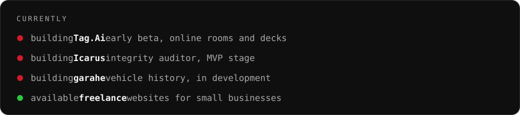
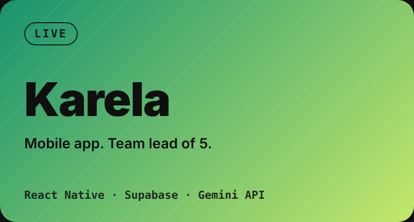
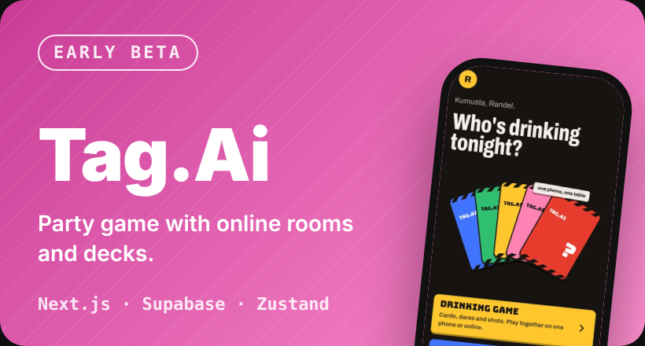
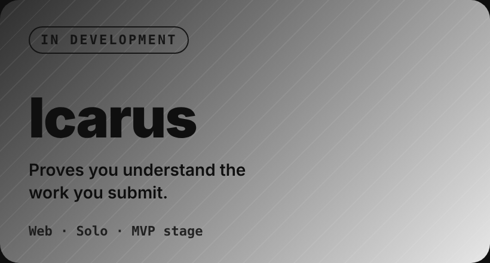
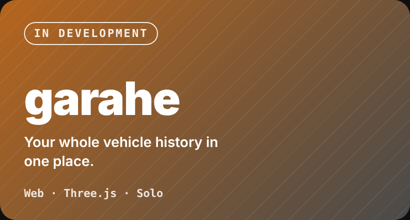
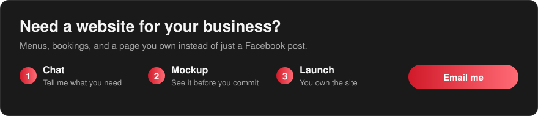

<picture>
  <source media="(prefers-color-scheme: dark)" srcset="https://raw.githubusercontent.com/Dell015/Dell015/output/github-snake-dark.svg">
  
</picture>

  

  

 

  

<table>
  <tr>
    <td></td>
    <td></td>
  </tr>
  <tr>
    <td></td>
    <td></td>
  </tr>
</table>

 

  

Philippine Startup Challenge 10 regional finalist · IgnITE Start-Up Competition 1st runner-up · 2025

