<picture>
  <source media="(prefers-color-scheme: dark)" srcset="https://raw.githubusercontent.com/Dell015/Dell015/output/github-snake-dark.svg">
  
</picture>

  

  

  

## Selected work

| Project | What it is | Built with | Status |
| --- | --- | --- | --- |
| [**Karela**](https://karela-phi.vercel.app) | Mobile app. I led a team of 5. | React Native, Supabase, Gemini API | Live |
| [**Tag.Ai**](https://tag-ai-omega.vercel.app) | Party game with online rooms, decks and coins. | Next.js, TypeScript, Supabase | Early beta |
| **Icarus** | Quizzes you on the work you submit to prove you understand it. | Web, solo | MVP stage |
| **garahe** | Private vehicle history and maintenance tracker. | Web, Three.js, solo | In development |

Philippine Startup Challenge 10 regional finalist · IgnITE Start-Up Competition 1st runner-up · 2025
